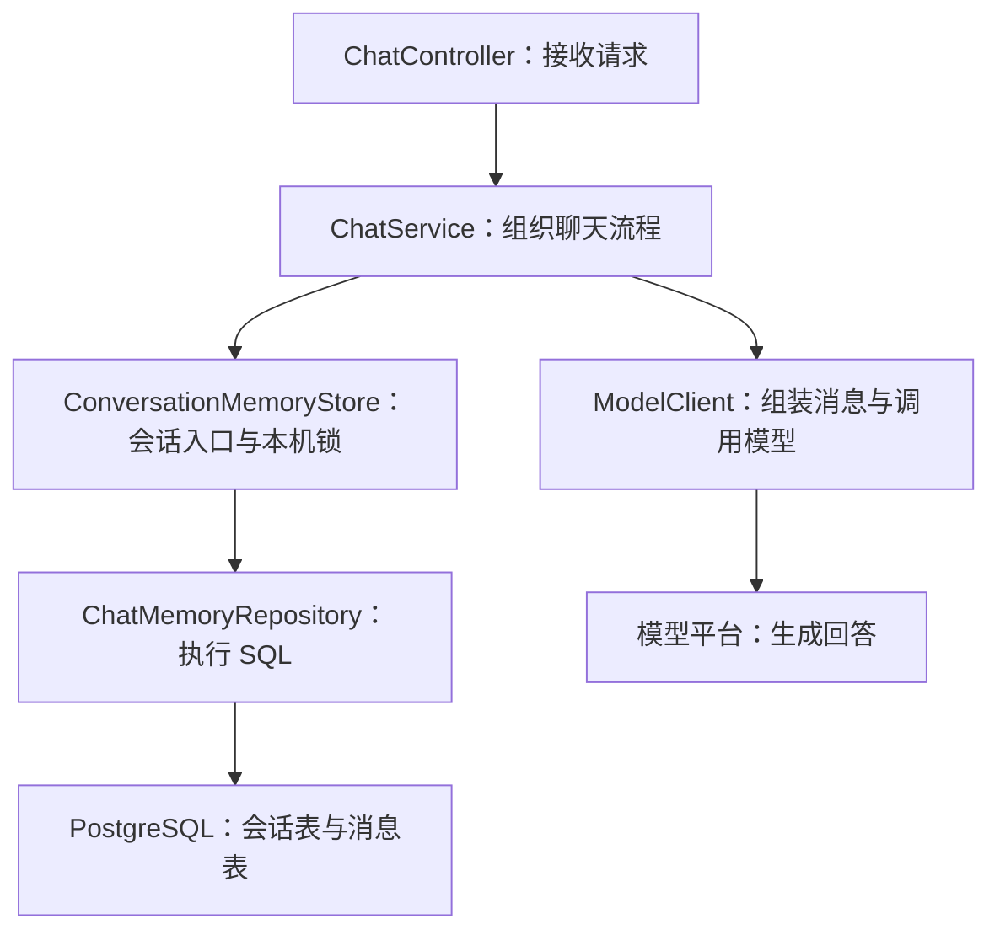

# 第 05 步：聊天记忆持久化——架构、代码与验收

> 多模块更新：当前目录、构建与启动见[第 11 步](11-maven-modules.md)。以下为历史课程，旧增量包不能覆盖当前模块目录。

> 课程历史笔记。当前启动、认证和数据访问以 README 与第 10 步为准：所有业务 API 需 Bearer，Service 为接口＋Impl，数据库访问使用 Mapper。下方推导示例保留用于理解演进。

本次起点：基础聊天、会话隔离、系统提示词和流式输出已跑通；PostgreSQL 已连接，`chat_conversation` 和 `chat_message` 两张表已创建。

本次目标：聊天消息保存到 PostgreSQL；后端重启后，同一个会话仍可读取历史。Git 提交放在本功能验收之后。

## 1. 本次要掌握的主线

普通与流式聊天都遵循：**校验输入 → 读取本会话的历史 → 调用模型 → 得到完整回答 → 在事务里保存问题和回答 → 返回成功结果。**

这里的数据库存储解决“记录能保留下来”。后续 Embedding 和 pgvector 解决“从文档中按语义检索资料”，两者用途不同。



图表示类之间的调用关系；实际顺序是先读历史，再调用模型，成功后保存这一轮。

## 2. 为什么只改两个类

| 文件 | 本次职责 |
|---|---|
| 新增 `chat/memory/ChatMemoryRepository.java` | 用 `JdbcTemplate` 读写两张表 |
| 替换 `chat/memory/ConversationMemoryStore.java` | 把原来的 `history()`、`appendTurn()` 转交 Repository，保留同一会话共用的对象和锁 |

现有 `ChatService` 已经把读取、模型调用、保存放在正确的位置，因此这次沿用它的流程。现有 Controller 的 JSON 与 SSE 错误通道也能处理本次新增的业务异常。

这对应原 Ragent 中的数据库记忆职责：原项目的 `ConversationMemoryStore` 接口和 `JdbcConversationMemoryStore` 实现连接到会话、消息服务。当前学习版先以两个类承接这个职责，再随功能增加拆分接口与模块。

## 3. Repository 怎么得到数据库访问能力

新增类声明 `@Repository`，Spring 会创建并管理它。构造方法需要 `JdbcTemplate`；Spring Boot 会根据 JDBC 依赖和数据源配置准备这个对象并注入。

随后 `ConversationMemoryStore` 的构造方法需要 `ChatMemoryRepository`，Spring 继续注入 Repository。`ChatService` 则继续使用 Spring 注入的记忆存储。

你需要能说清楚“需要哪个对象、这个对象负责什么”，现在可以参照已有构造方法写法，不要求闭卷背注解与框架源码。

## 4. Map 现在还在，里面放什么

旧版本：每个 `Conversation` 对象内部有一个 `messages` 列表，消息存在 Java 内存中。

新版本：每个 `Conversation` 对象内部保存会话编号与 Repository 引用。`history()` 每次去数据库查询；`appendTurn()` 每次调用 Repository 保存。

Map 仍按会话编号保存 `Conversation` 对象，目的是让同一会话的请求获得同一个锁对象。`ChatService` 的 `synchronized (conversation)` 仍覆盖“读历史—模型调用—保存”这一整个过程。

- 同一个会话的请求在当前后端进程中串行处理。
- 不同会话有不同的锁对象，可以并行处理。
- 后端重启后 Map 是新的；因为消息在 PostgreSQL 中，新的会话对象照样能查询旧消息。
- `getOrCreate()` 创建的是本机会话对象；本次实现到首次成功保存时才插入数据库会话记录。

本机 Map 当前没有总量上限与清理策略；它也不协调多个后端进程。后续的用户归属校验和 Redis 运行控制会继续完善边界。

## 5. 历史读取：为什么先 DESC 再 ASC

`loadRecentMessages(conversationId, maxMessages)` 执行的 SQL 分两层：

1. 内层按 `conversation_id` 过滤，`ORDER BY id DESC LIMIT ?` 取最新的若干条。
2. 外层 `ORDER BY id ASC`，恢复模型需要的“旧消息在前、新消息在后”。

假设已有 20 条消息，要取最近 12 条：内层拿到编号 20 到 9；外层恢复为 9 到 20。

`JdbcTemplate` 会逐行调用 `(rs, rowNum) -> ...`，把一条数据库记录转成 `Map.of("role", ..., "content", ...)`。这些 Map 正是现有 ModelClient 使用的历史消息格式。

这里的 Lambda 是结果转换回调，查询代码在当前线程调用它。它不会因为使用 Lambda 就自动创建线程。

SQL 中的 `?` 是参数占位符，后面的 `conversationId`、`maxMessages` 由 JDBC 绑定，不把用户输入拼接到 SQL 文本中。

## 6. 最近六轮与完整聊天记录

`MAX_TURNS = 6` 表示每次读取最近 12 条消息，供模型生成当前回答。

**数据库保留全部已成功保存的轮次；历史窗口只决定本次发给模型多少条。** 新版不再像旧内存版那样删除较早消息。

要改成最近 10 轮，修改 `ConversationMemoryStore` 中的 `MAX_TURNS`，并核对调试器中返回历史的长度和顺序。不要用删除数据库旧记录来实现模型历史窗口。

系统提示词仍由 `ChatService` 提供，当前问题仍由 ModelClient 加到消息末尾；它们不需要预先写入历史表。

## 7. 保存：为什么需要事务

`ChatMemoryRepository.appendTurn()` 中依次进行三次写入：

1. 如果会话不存在，插入会话记录。`ON CONFLICT (conversation_id) DO NOTHING` 让已有会话可以继续使用。
2. 插入 `role=user` 的问题。
3. 插入 `role=assistant` 的回答。

方法上的 `@Transactional` 让这三次写入属于同一个数据库事务。例如第三步因为约束错误失败，前面写入的问题和本次新建的会话记录会一起回滚。

事务依赖 Spring 管理的 Repository 代理。记忆存储通过注入的 Repository 调用这个公开方法，事务才会按预期生效。业务代码不要自行 `new ChatMemoryRepository(...)` 绕过 Spring。

事务只围绕这几次数据库写入；模型生成时不占着这个写入事务。Service 外面的 Java 会话锁仍然存在，它与数据库事务解决的不是同一个问题：锁组织本机同会话请求的先后，事务保证本轮写入的一致性。

## 8. 流式回答什么时候保存

`delta` 仍然可以一段段发给页面。ModelClient 成功读到完整结果，Service 完成取消检查后，才调用 `appendTurn()`。

Repository 的事务提交成功，调用正常返回之后，Controller 才会走正常的 `done` 分支。

| 情况 | 本轮数据库写入 |
|---|---|
| 输入为空，Service 校验失败 | 不读取或写入聊天记录 |
| 模型调用失败、流中途结束、返回不完整 | 不调用本轮保存 |
| 生成途中已发现取消并抛出取消异常 | 不调用本轮保存 |
| 保存时发生明确的事务失败并回滚 | 本轮写入一起回滚，之前成功的历史保留 |
| 回答生成并保存成功 | 增加两条消息 |

完整回答的数据库提交、浏览器收齐最后一个事件、取消通知，是不同的动作。若取消发生在最终检查之后，或数据库已提交而最后一个事件发送失败，完整轮次仍可能已经入库。连接在提交时中断，也可能需要查询数据库才能确认最终提交结果，因此保存错误提示要求先确认记录再重试。

## 9. 数据库错误如何回到页面

记忆存储把数据库访问或事务异常转成现有的 `ChatApiException`：

| 阶段 | 错误码 | 普通聊天 | 已建立的流式聊天 |
|---|---|---|---|
| 读取历史失败 | `CHAT_HISTORY_LOAD_FAILED` | HTTP 503 JSON | SSE `error` 事件 |
| 保存记录失败 | `CHAT_HISTORY_SAVE_FAILED` | HTTP 503 JSON | SSE `error` 事件 |

已建立的 SSE 响应可能已经是 HTTP 200，页面仍要看 `error` 事件。页面出现部分回答不等于保存成功，应结合结束事件和数据库记录确认。

启动时连接失败仍会让自动建表初始化失败，程序无法启动。运行中的读写异常处理不能代替启动配置检查。

## 10. 按这个顺序验收

### A. 合并并启动

按 README 新增 Repository、替换记忆存储，确认 PostgreSQL 正在运行，重新启动 Java 后端。

旧版 Map 中的数据不会自动迁移进数据库。下面使用一个之前没用过的会话编号进行测试。

### B. 普通聊天成功后，在数据库找到两条记录

在 Apifox、IDEA HTTP Client 或你已有的测试方式中发送：

```http
POST http://localhost:18081/api/chat
Content-Type: application/json
```

```json
{
  "conversationId": "pg-study-001",
  "question": "请记住：我的学习代号是青竹27。回答时确认这个代号。"
}
```

等待完整回答，在 IDEA 数据库连接的查询控制台执行：

```sql
SELECT conversation_id, created_at
FROM chat_conversation
WHERE conversation_id = 'pg-study-001';

SELECT id, conversation_id, role, content, created_at
FROM chat_message
WHERE conversation_id = 'pg-study-001'
ORDER BY id;
```

第一次成功请求后，应有一条会话记录、两条消息记录，消息角色顺序为 user、assistant。

### C. 重启后端，再续聊

停止 Java 后端，再启动。随后发送：

```json
{
  "conversationId": "pg-study-001",
  "question": "我之前告诉你的学习代号是什么？"
}
```

请求本身没有代号。检查模型是否能回答“青竹27”，再查数据库：本次成功后应新增两条消息，当前会话合计四条。

模型回答有随机性；数据库记录和历史读取结果是更直接的证据。需要定位时，在 `ConversationMemoryStore.history()` 返回前观察查询到的消息。

### D. 流式聊天共用历史

打开 `http://localhost:18081/stream-test.html`，会话编号填写 `pg-study-001`，问题填写“请说出我的学习代号，再解释为什么后端重启后还记得”。

应看到分段输出，并收到完成提示。再次查询数据库，这次成功应再增加两条消息。用普通接口继续这个会话，也应读到流式成功保存的轮次。

### E. 不同会话隔离与参数错误

换一个新编号 `pg-study-other` 询问学习代号；在调试器中检查它读取不到 `pg-study-001` 的历史。

用有效会话编号和空问题发送请求，应返回现有的 HTTP 400 校验错误，该会话消息数不增加。

以上验收通过后，再用 IDEA 提交本次功能。可用提交说明：`feat: 持久化聊天记录并支持重启后续聊`。

## 11. 常见问题与定位位置

| 现象 | 优先看哪里 |
|---|---|
| 提示数据库 URL 未配置 | YAML：`datasource` 必须在 `spring` 下 |
| 提示密码认证失败 | Java 运行配置中的 `DB_PASSWORD`，以及变量之间的英文分号 |
| IDEA 面板能连接，Java 连接失败 | 面板与 Java 各自的连接配置，检查是否同一个地址、数据库与密码 |
| 能回答，但数据库没有消息 | 是否替换了记忆存储；是否仍运行旧后端；查的是不是 `ragent_learning` 和本次会话编号 |
| 重启后忘记了 | 请求中的会话编号、Repository 查询结果、发给模型的 messages |
| 内容包含引号或中文 | JDBC 参数绑定；不要自行给用户内容拼接 SQL 引号 |
| 较早消息仍能在数据库查到 | 符合设计：保存完整记录，每次只读取最近六轮 |
| 写入失败后消息编号有间隔 | 自增序列可能留空号，不应以编号连续作为事务成功依据 |

## 12. 读代码时先回答这五件事

1. Service 在哪一行读取历史，在哪一行保存？
2. Map 中现在还有没有 `messages` 列表？消息真正存在哪里？
3. 查询为什么需要先倒序取最近的，再正序排列？
4. `@Transactional` 保护的是哪三次写入，为什么不把模型调用也包进去？
5. 流式页面已经出现文字，为什么仍可能收到“保存失败”？

现在能顺着类找到这五个答案，就达到这一阶段的理解目标。SQL 参数绑定、结果集回调和事务注解可以参照现有代码使用。

## 13. 官方资料

- Spring JDBC：[JdbcTemplate API](https://docs.spring.io/spring-framework/docs/current/javadoc-api/org/springframework/jdbc/core/JdbcTemplate.html)
- Spring 事务：[使用 @Transactional](https://docs.spring.io/spring-framework/reference/data-access/transaction/declarative/annotations.html)
- PostgreSQL：[INSERT 与 ON CONFLICT](https://www.postgresql.org/docs/current/sql-insert.html)

## 14. 本次增量包的本地验证范围

已将前面各步骤与本次两个类合并，使用 Java 17、Maven 3.9.11、Spring Boot 4.1.0 完成整工程编译与打包。实际加载的 Spring JDBC 版本为 7.0.8。

随后运行真实 Spring Boot 后端、JDBC 驱动和事务代理，连接 PGlite 0.5.12 的 PostgreSQL 18.6 WASM 引擎，通过本地模拟模型接口完成了 11 组检查：自动建表、中文与引号原样保存、真实 Java 进程重启后读取历史、HTTP SSE 分段发送与保存、会话隔离、最近六轮窗口与完整留存、输入校验、模型失败和不完整流、写入失败回滚、读库失败的 JSON/SSE 错误、同会话并发串行处理。

回滚检查实际让 assistant 消息违反数据库约束，确认已写入的 user 消息与本次新建会话一起回滚。重启检查停止了 Java 进程并重新启动，随后核对模型请求中包含数据库里的旧历史。

测试数据库是 PGlite，连接池限制为一个连接；它不能替代本机 Docker PostgreSQL 的多连接环境验收。模拟模型也不能替代你的真实千问调用。本说明第 10 节是你本机需要完成的功能验收。

