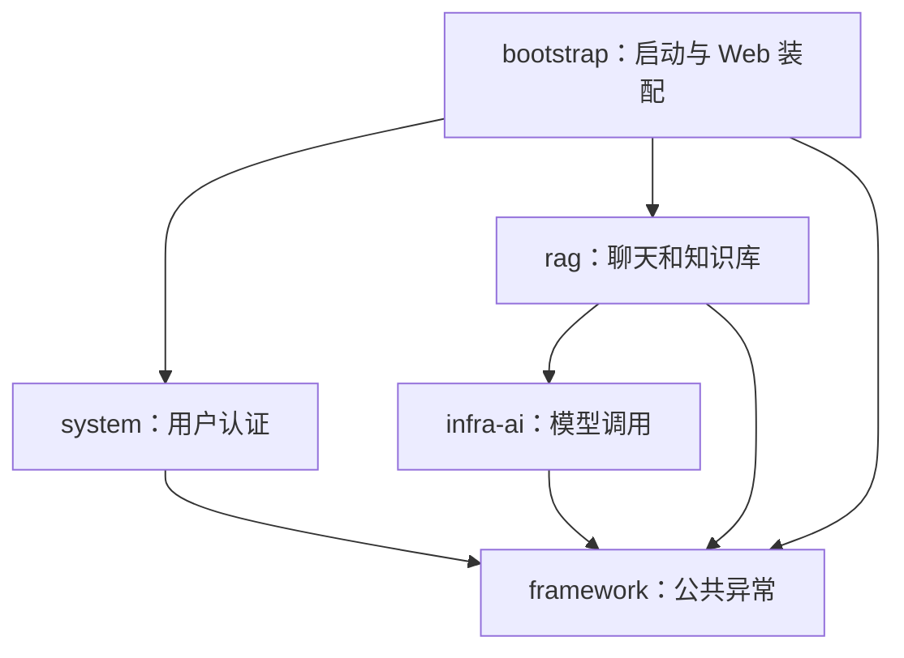

# Maven 多模块整理与开发流程

> 当前进度：已接通知识库检索问答，见 [D11 说明](13-knowledge-rag.md)。下文保留对应阶段的实现边界和验收记录。

> 后续更新：D10 已新增文档切分及算法单元测试；最新功能与验收见[第 12 步](12-document-chunking.md)。下文保留模块化当次记录。

## 本轮范围

2026-10-31，根据新的模块化目标，将现有学习工程整理为原项目风格的五个 Maven 模块。原先 AGENTS 中“保持单工程”的约定已同步更新。本轮保持已有技术版本、业务接口、数据库结构、认证协议、提示词及解析语义。

迁移前工作区已备份到忽略目录 `data/module-migration-baseline-2026-10-31T09-24-25-680Z`；包含源码、运行资源、POM、规范、讲义、请求样例、脚本和 Git 状态。没有提交、推送或硬重置。

## 最终目录

```text
ragent-learning/
├── pom.xml                   父工程：聚合、继承与版本管理
├── framework/
│   ├── pom.xml
│   └── src/main/java/        共用的 ChatApiException
├── infra-ai/
│   ├── pom.xml
│   └── src/main/java/        模型客户端与模型协议解析
├── system/
│   ├── pom.xml
│   └── src/main/java/        用户、注册登录、Sa-Token/Redis 配置
├── rag/
│   ├── pom.xml
│   └── src/main/java/        chat、knowledge 及其各层
├── bootstrap/
│   ├── pom.xml
│   └── src/main/
│       ├── java/             启动类、全局异常处理与 Web 响应头
│       └── resources/        application.yaml、db、static
├── docs/
│   ├── http/                 认证、聊天、持久化、知识库请求样例
│   ├── archive/main.zip      原有源码压缩包，字节保留
│   └── …                     学习说明及配置示例
├── scripts/                  独立数据回归与浏览器验证
├── data/                     已有文件数据和本机备份，Git 忽略
└── target/                   本机验证报告、测试工具，Git 忽略
```

模块中只创建当前确实需要的目录。各模块的 target 在构建时产生，没有机械创建空的 test/resources 或尚未实现的 agent、mcp-server。

## 依赖与职责

箭头表示左边引用右边，越靠底层越不应知道上层业务：



- framework 当前只放多个模块共同使用的异常，不为了填目录引入抽象框架，也不依赖其他业务模块。
- infra-ai 不反向引用聊天 Service、用户 Service 或知识库组件；通过参数接收系统提示词、历史和问题。
- system 管理用户、BCrypt、Sa-Token 和 Redis，会话认证配置由应用装配时生效。
- rag 内部保持 chat、knowledge 按业务分包，每个包内保留 Controller、Service 接口/Impl、Mapper、DO、DTO/VO 等职责。解析器、存储组件继续留在知识库业务内。
- bootstrap 只做启动、全局 Web 错误处理和资源配置，不放聊天或解析业务流程。

原项目的 rag 引用了 system；学习版当前 Controller 直接使用 Sa-Token API，业务显式接收可信 userId，没有引用 system 的 Java 类型，因此暂不添加 rag→system 的空依赖。bootstrap 同时装配它们，入口认证仍覆盖全部业务 API。

`ChatApiException` 留在 framework 原包 `common`；全局 HTTP 异常处理和响应头移动到 bootstrap 的 `bootstrap.web` 包。其余业务 Java 包名保留，避免为了目录外观大量修改 import。

## 父 POM 和子 POM

根 POM 的 packaging 是 pom，modules 聚合五个子工程，继承原来的 Spring Boot 4.1.0 父配置。dependencyManagement 统一管理模块版本、MyBatis-Plus 3.5.18、Sa-Token 1.46.0、Tika 3.3.3；它不表示每个模块自动使用全部依赖。

各子模块只在自己的 dependencies 声明需要的库。framework 无外部依赖；infra-ai 不会因为父工程而拿到数据库、Redis、认证 starter 或文档解析依赖。Maven 按依赖关系构建，循环依赖会导致构建失败。[Maven 多模块说明](https://maven.apache.org/guides/mini/guide-multiple-modules.html)

Spring Boot Maven 插件只放 bootstrap。四个业务/基础模块是普通 JAR，bootstrap 的 repackage 把它们和运行依赖放入可运行 JAR；不能将基础模块也重新打包成启动包。[Spring Boot 打包说明](https://docs.spring.io/spring-boot/maven-plugin/packaging.html)

最终产物：`bootstrap/target/bootstrap-0.0.1-SNAPSHOT.jar`。根工程不再产生旧的单工程可运行 JAR。

## 启动与数据路径

IDEA 重新加载**根 pom.xml**后，检查 Maven 面板识别五个模块。运行配置中：

1. Main class 仍为 `com.dujiteng.ragentlearning.RagentLearningApplication`。
2. Use classpath of module 选择 bootstrap（IDEA 若显示工程名前缀，选对应的 bootstrap 子模块）。
3. Working directory 设置 `D:\jastudy\idea\ragent-learning`。
4. 保留原有 DB_PASSWORD、REDIS_PASSWORD 和模型环境变量。不要把密码写进共享运行配置或 POM。

启动类仍位于共同根包，组件扫描和 MyBatis Mapper 扫描覆盖各模块；拆目录不会改变 HTTP 路由。配置、SQL 和页面统一在 bootstrap 的 resources，运行时类路径仍为 application.yaml、db/chat-schema.sql、static 等原路径。

默认原文件目录仍为根目录下 data/knowledge。IDEA 的工作目录必须保持根目录；Maven run 插件也显式设置根工作目录，避免误用 bootstrap/data。部署时可用绝对路径 KNOWLEDGE_STORAGE_ROOT。

从工程根目录执行：

```powershell
mvn clean verify
java -jar bootstrap/target/bootstrap-0.0.1-SNAPSHOT.jar
```

若使用 Maven run，先将本工程模块安装到**本机 Maven 仓库**，再仅运行 bootstrap：

```powershell
mvn install -DskipTests
mvn -pl bootstrap spring-boot:run
```

install 是本机构建产物安装，与 Git 提交/推送无关。不要把 spring-boot:run 与 -am 一起用于全部模块，以免父工程或类库也尝试寻找启动类。

## 以后怎样开发

先判断职责，再决定模块和类。例如增加模型请求适配去 infra-ai；增加文档格式解析去 rag/knowledge/parse；调整注册约束去 system；全局 HTTP 装配才进入 bootstrap。业务模块内仍遵循 Service 接口＋Impl 与 Mapper 的既有规则。

需要引用其他模块的 Java 类型时，先判断依赖方向是否合理，再在 POM 声明依赖。若方向不允许，应重新安排职责，不能用“把所有模块都互相依赖”解决编译错误。

修改 rag 后可用 `mvn -pl rag -am verify` 检查它及所需模块。交付前从根工程构建，并运行完整回归；单独某个模块编译成功不代表启动装配完整。

本轮未新接入检索或 Agent；未来 Agent 仍沿原项目 AgentScope，届时按实际需求新增 agent 模块。

## 验证

```powershell
mvn clean verify dependency:build-classpath "-Dmdep.outputFile=target/parser-classpath.txt"
npm install --prefix target/browser-check --no-save playwright-core@1.64.1
$env:RUN_BROWSER_CHECK = 'true'
node scripts/verify-knowledge.mjs
```

脚本使用 bootstrap 的实际可运行 JAR，rag 的解析依赖类路径，检查模块依赖及打包结构，并复跑原有业务与真实 Edge 操作。数据库、Redis、端口和文件全部隔离，模型为本机假服务。准确结果见 [本轮验收记录](11-maven-modules-verification.md)。
