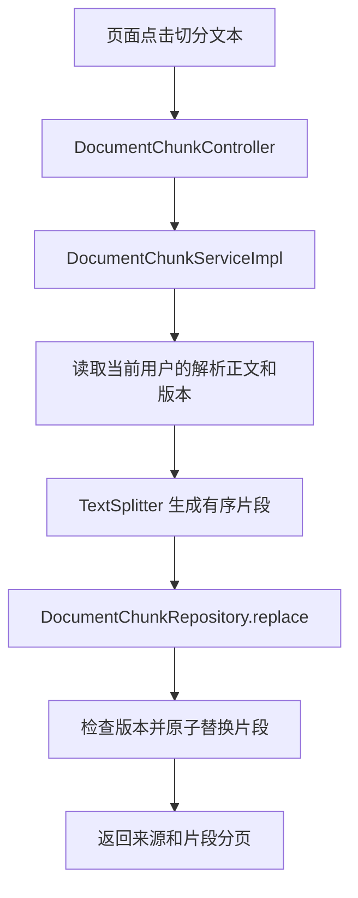

# D10：文档切分与来源信息

> 当前进度：已接通知识库检索问答，见 [D11 说明](13-knowledge-rag.md)。下文保留对应阶段的实现边界和验收记录。

## 这一阶段做什么

原文件经过 D9 解析，已经得到 parsed_text。D10 把这段长文字整理成可单独定位的小片段，保存到 PostgreSQL，并在页面分页查看。

例如把一篇资料切成多块，每块最多 800 个字符，下一块带上前一块末尾的 120 个字符。重叠让跨越切点的说明保留上下文；之后检索命中一块时，能找到它来自哪个文件和哪个位置。

这一阶段仍没有 Embedding、向量检索或基于资料的回答。普通聊天继续沿用原来的模型调用与提示词，切分过程不调用模型。代码与 AI 回归已完成；2026-10-31 用户确认本机能完成切分，截图展示 chunk-demo.md 共 7 块，并能查看正文、顺序和来源位置。详细确认范围见验收记录。

## 切分规则

- 默认 chunkSize=800、overlap=120。chunkSize 范围 200～4000，overlap 为 0～chunkSize/2。未传参数时使用默认值；自定义长度时应同时填写合适的重叠值。
- 长度按 Unicode 码点计算，中文与普通 Emoji 不会因为 Java UTF-16 的代理项而被切坏。码点不等同于模型 Token，也不等同于一个视觉字形；组合 Emoji 可能包含多个码点，本轮没有字形簇边界保证。
- 在长度预算内优先段落、换行和句末边界；没有自然边界时按长度切开。为保证前进速度，只在窗口后半段附近寻找边界。
- 保留解析正文的字符，片段内容可以通过 startOffset/endOffset 回到 parsed_text 对照。位置是 Unicode 码点的左闭右开区间，不是原文件字节、PDF 页码或 Java substring 的 UTF-16 下标。
- chunkIndex 从 0 开始，页面显示时加 1。每个片段有数据库 id、documentId、正文、字符数和原文位置；分页响应包含文件名及正文版本。
- 每份文档最多 5000 个片段，超过返回 422，提示调整预算；不会截掉后面的正文并冒充成功。

## 代码放在哪里

所有业务代码都在 rag 模块的 `com.dujiteng.ragentlearning.knowledge` 下：

| 位置 | 职责 |
| --- | --- |
| controller/DocumentChunkController | 接收切分/分页请求，取得可信 userId |
| service/DocumentChunkService | 声明切分与查看片段能力 |
| service/impl/DocumentChunkServiceImpl | 查归属和正文、校验参数、组织切分与保存 |
| chunk/TextSplitter | 纯文本切分；不调用数据库或模型 |
| repository/DocumentChunkRepository | 版本检查、短事务整批替换、读取一致的分页快照 |
| mapper/KnowledgeChunkMapper | 批量 INSERT、带用户归属的分页 SQL |
| entity/KnowledgeChunkDO | 映射 knowledge_chunk，不直接作为接口响应 |
| dto/ChunkRequest | 切分参数 |
| vo/DocumentChunkVO、DocumentChunksVO | 片段及来源、分页信息 |
| config/KnowledgeMybatisConfig | PostgreSQL 的 MyBatis-Plus 分页插件 |

MyBatis-Plus 的分页插件需要独立 jsqlparser 依赖，本轮固定为与现有组件相同的 3.5.18，没有升级主框架。[官方分页说明](https://baomidou.com/plugins/pagination/)

## 顺着一次点击读代码

先读 Controller 的 chunk 方法，再读 ServiceImpl.chunk，最后看 TextSplitter.split。你应能指出：正文从哪里来、长度/重叠怎样影响切点、片段在哪里保存。Mapper、行锁和事务细节可以在主流程熟悉后继续跟。

## 保存和重新解析的边界

数据库脚本在 bootstrap/src/main/resources/db/chat-schema.sql 末尾幂等增加 knowledge_chunk 表，以及文档的 parse_version、chunk_version、chunk_size、chunk_overlap、chunk_count、chunked_at 字段。保留旧文档、正文、主键、约束和归属。已有成功解析记录的初始版本为 0，可以直接切分。

切分计算在事务外；保存时经独立 Repository Bean 的 @Transactional 代理：

1. 带用户归属锁定文档行，确认仍为成功解析且版本与切分输入一致。
2. 同一版本和相同参数已成功切分时，直接复用结果，编号保持稳定。
3. 参数变化时，删除旧片段，再按每批 200 条写入新片段，更新统计。
4. 所有批次和统计在同一事务提交；任何批次失败，旧片段与统计一起恢复。

文档行锁协调同文档写入及重新解析，数据库会在事务结束释放锁。[PostgreSQL 行锁说明](https://www.postgresql.org/docs/16/explicit-locking.html#LOCKING-ROWS)

重新解析开始时清空切分有效标记；成功解析增加 parse_version。旧片段可能暂留在数据库中，但读取接口只返回当前成功正文版本的有效片段，下次成功切分再原子替换。因此解析失败、处理中或尚未重新切分时，不会把旧片段作为最新结果展示。

失败切分不改变 D9 的解析成功/失败状态，不覆盖解析失败原因。写库失败返回明确 503；当前版本原有有效片段保留。这里没有额外引入长时间后台任务或另一套 RUNNING 租约。

## 接口

两条接口都使用已有 Authorization: Bearer，并检查 user、knowledgeBase、document 的归属。

| 方法 | 路径 | 行为 |
| --- | --- | --- |
| POST | /api/knowledge-bases/{kbId}/documents/{docId}/chunks | JSON 可选，生成/重用当前版本片段，返回第一页 |
| GET | 同上，加 ?page=1&size=20 | 按 chunkIndex 正序分页，size 为 1～100 |

POST 示例：`{"chunkSize":800,"overlap":120}`。

未登录 401；他人资源/跨知识库编号 404；参数错误 400；未解析或原文更新冲突 409；片段数量超限 422；数据库失败 503。查看尚未切分的合法文档返回 200、PENDING 和空列表，页面据 documentStatus 提示先解析或先切分。

## 本机怎样验收

1. IDEA 重新加载根 POM并重启 bootstrap；沿用原来的环境变量，工作目录仍为工程根目录。启动时自动执行幂等增量 SQL，不需要删表。
2. 打开知识库页，上传或选择一份较长的文档，成功解析后点击“切分文本”。
3. 点击“查看片段”，检查文件名、总数、编号、顺序与原文位置，使用上一页/下一页。
4. 对照相邻两块末尾与开头，理解重叠文字。可把长度改成 400、重叠改成 80，再切一次比较效果。
5. 相同参数重复切分，数量与编号不应重复增加。
6. 点击重新解析，再查看片段应提示尚未切分；重新切分后恢复。
7. 刷新或重启 Java 后，再点击查看片段，结果应保留。

准备了一份可直接上传的长文 [chunk-demo.md](examples/chunk-demo.md)，HTTP 样例已追加到 docs/http/knowledge-requests.http。界面展示的 SUCCESS 仍只表示对应阶段完成：解析完成不等于切分完成，切分完成不等于已能检索问答。

## 与原项目对应

原项目 core/chunk/ChunkingService 组织分块，core/chunk/text/TextSplitter 处理文本自然边界，knowledge/service/impl/KnowledgeChunkServiceImpl 与知识库落库组件管理片段。学习版保留“解析 → 分块 → 保存来源”的职责，暂时使用平文本和字符预算，没有复制结构化 Block、标题上下文、表格/代码专门切分、DAG、Embedding 或多索引落点。

后续 D11 已接入 Embedding、向量入库和知识库问答；本节先掌握长度、重叠、顺序和来源。未来 Agent 仍按既定 AgentScope 路线。

## 验证

9 个切分单元测试、38 组集成/真实 Edge 回归已通过。覆盖 Unicode、自然边界、完整覆盖、分页、归属、幂等、第二批写入故障回滚、并发、重解析、旧版本写入拒绝及 Java 重启。详细实际记录见 [D10 验收记录](12-document-chunking-verification.md)。

本轮没有调用真实付费模型，没有向用户现有业务数据库写入测试记录。单元测试验证的是码点与字符覆盖，不能推断复杂 PDF 表格或组合字形的语义切分效果。
