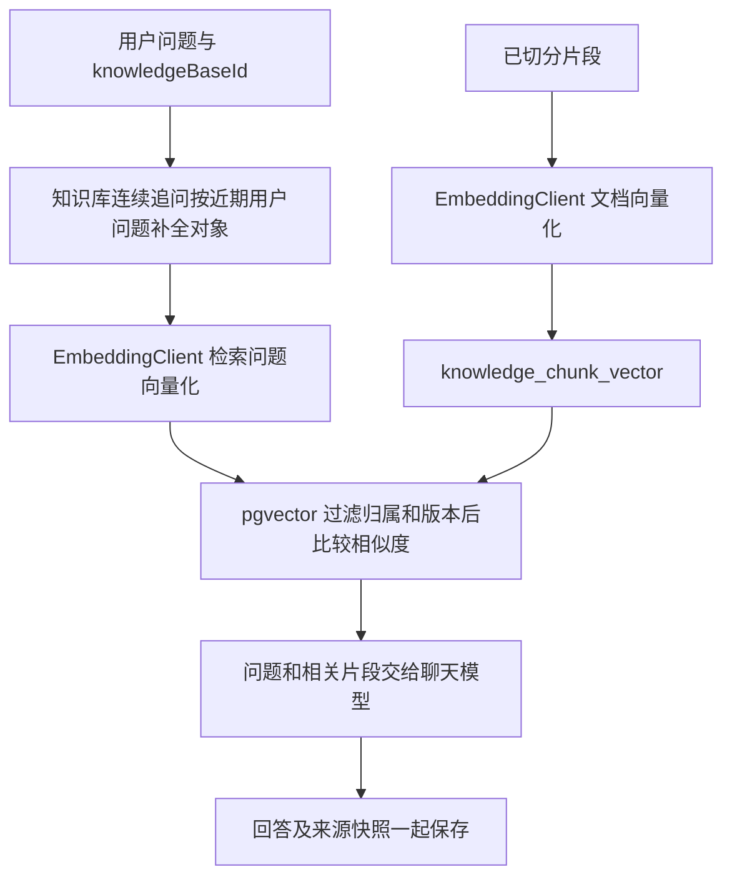

# D11：让问题连接知识库

现在已经形成最小 RAG 闭环：上传 → 解析 → 切分 → 文档向量化 → 问题向量化 → 检索相关片段 → 模型依据资料回答 → 保存问答与来源。

## 先在 IDEA 中验收

1. 重新构建并重启 `RagentLearningApplication`，使用 bootstrap 模块类路径、工程根工作目录及原来的数据库、Redis、千问环境变量。
2. 当前百炼地址可以自动派生 Embedding 地址，默认复用 `LLM_API_KEY`，模型固定默认 `text-embedding-v4`、向量 1024 维，无须再填一份密钥。其他提供方须明确配置 `EMBEDDING_URL`、`EMBEDDING_MODEL`，必要时配置 `EMBEDDING_API_KEY`，且须支持 OpenAI 兼容的 1024 维返回。
3. 同一标签页登录，进入知识库页。已有切分成功的文档可直接点“向量化”；尚未完成的文档按解析、切分、向量化顺序操作。
4. 返回聊天页，在“回答依据”选择该知识库，填写资料中确实包含答案的问题，选择完整回答或逐段显示。
5. 回答下方应出现 `[1] 文件名 · 第几块 · 相似度`。展开即可核对模型实际收到的片段；最近历史也保留来源。
6. 切换“回答依据”会新建会话，防止普通聊天或另一知识库的历史混入。选择最近会话时恢复原知识库。

先用 [rag-demo.md](examples/rag-demo.md) 提问：“星河学习项目的验收口令是什么？”这份合成资料中才有答案，适合区分知识检索与模型凭自身知识回答。

向量化会调用外部服务。相同文档版本、切分参数和模型空间重复点击会复用已成功的向量。每次检索仍需要一次问题Embedding；有命中时再调用聊天模型。D15起知识库连续提问默认额外做一次短超时问题改写，首轮/普通聊天不增加这次调用；歧义澄清跳过检索和生成，见 [D15](16-query-rewrite.md)。不要用很长的文档反复试错，默认单文档上限500块。

### 普通聊天和知识库模式容易混淆的地方

“我的最近会话”选择聊天记录，“回答依据”才选择知识库。把会话编号改成 `minrag` 不会启用检索；已有普通会话也不会因为上传了文件就自动绑定资料。页面现在会明确显示“当前模式：普通聊天 · 未使用知识库”或“当前模式：知识库问答 · 知识库名称”，完成回答后也显示后端确认的模式和来源数量。

如果截图里完全没有“回答依据”，而知识库页面已经能向量化，先强制刷新聊天页（Ctrl+F5），或在同一已登录标签页打开 `http://localhost:18081/login-test.html?v=knowledge-mode-2`。服务端已给学习 HTML 和 auth.js 增加 `Cache-Control: no-store`，后端重启后生效，减少旧页面继续发送旧协议的情况。发送新问题时会先清除上一轮的来源。

措辞变化不等于失败，但口令这类资料事实必须保持一致。只有出现实际资料来源并能与原文核对，才算知识库验收成功。普通聊天里关于“自动生成验收口令、绑定学习档案、解锁课程”等说法不是项目实际业务，不能凭生成文本判断后台执行了操作。

## 两条链，分开理解

入库链准备资料，问答链使用资料。Embedding 返回一组数字用于比较相似程度，聊天模型返回文本；两者职责不同。模型参数并没有因上传文档而发生训练或更新。

## 真实类和方法

| 阶段 | 调用链与职责 |
| --- | --- |
| 登录 | `AuthController.login → AuthServiceImpl.login → UserMapper`：读取账号、BCrypt 校验；成功后 Sa-Token 建立 Redis 会话。业务接口由拦截器验证 Token，Controller 获取可信 userId |
| 文本解析 | `KnowledgeController.parse → DocumentParsingServiceImpl.parse → KnowledgeRepository.startParsing → FileStorage/DocumentParser → KnowledgeRepository.finishParsing`：占用解析任务、事务外读文件提取正文、以 token 条件保存结果 |
| 向量化 | `KnowledgeRetrievalController.index → DocumentIndexServiceImpl.index → DocumentVectorRepository.begin → EmbeddingClient.embed → DocumentVectorRepository.finish`：先认领片段快照，远程分批计算，最后短事务发布全部向量 |
| 检索 | `KnowledgeRetrievalServiceImpl.search → KnowledgeRepository.requireOwner → KnowledgeVectorMapper.countReady → EmbeddingClient.embed → KnowledgeVectorMapper.search`：先确认归属和可用索引，再向量化问题，数据库按余弦距离检索 |
| 完整回答 | `ChatController.chat → ChatServiceImpl.chat → prepare → RagWorkflow.prepare（改写/检索）→ RAGPromptService.build → LLMService.chat → Conversation.appendTurn → ChatMemoryRepository.appendTurn → MessageMapper.insertOwned` |
| 流式回答 | `ChatController.stream` 在请求线程验证身份和归属，将 userId/knowledgeBaseId 传给 worker；`ChatServiceImpl.streamChat` 完成检索、模型输出和保存，保存成功后 `done` 才返回 answer、sources、knowledgeBaseId |

自定义基础提示词和 `ModelClient` 保留。知识库模式只追加固定的资料使用规则；检索原文放在当前 **user 消息的 JSON 数据**中，避免把文档内容提升成 system 指令。资料不足时明确说明；没有过阈值片段时由后端直接拒答，不调用聊天模型。

模型看到检索包装后的问题，但数据库保存原始问题。`chat_message.sources_json` 保存该次回答的来源快照，因此后续文档重新解析或切分，不会把旧回答的来源偷偷替换成新版本。

D14发现收费幻觉与错引后，模型输入进一步收敛为显式citationId、文件名和正文。普通聊天发送原来的近期完整历史；知识库生成请求保留近期用户问题，将旧助手正文替换为占位消息，避免把过去的幻觉和旧引用当作本轮证据。数据库和页面仍显示完整历史。D15新增仅依据近期用户提问补全主体的检索改写；多问拆分和依赖助手答案中实体的指代仍未支持，也不代表通用事实核验。实际失败和修正验证见 [D14评估记录](14-rag-evaluation.md)。

## 包与依赖

模块依赖不变：bootstrap → system/rag/framework，rag → infra-ai/framework。没有新增 Maven 模块或业务依赖版本升级。

- `infra-ai/infra/embedding/EmbeddingClient`：外部 Embedding 协议、分批上限、维度/数值/顺序检查。
- `rag/knowledge/controller`：向量化、状态与检索预览入口。
- `rag/knowledge/service`、`service/impl`：向量化和检索业务接口及实现。
- `rag/knowledge/repository/DocumentVectorRepository`：任务租约、版本核对与整批发布事务。
- `rag/knowledge/mapper/KnowledgeVectorMapper`：pgvector 自定义 SQL；向量字符串用绑定参数 `CAST(... AS vector)`，不拼接用户 SQL。
- `rag/knowledge/entity`、`dto`、`vo`：表映射、请求参数和可公开的结果，响应不返回向量、密钥或文件存储键。
- `rag/chat`：已有聊天流程增加可选知识库与来源，普通模式保持可用。
- `bootstrap/src/main/resources`：配置、幂等数据库迁移和两个页面的入口。

## 数据库与版本保护

启动时执行原 `db/chat-schema.sql`，D11 段使用 `CREATE EXTENSION IF NOT EXISTS vector`、`ADD COLUMN IF NOT EXISTS` 和 `CREATE TABLE IF NOT EXISTS`。当前本机 PostgreSQL 16 已提供 pgvector 0.8.6，数据库账户需有启用扩展权限；不支持时启动明确失败，不能用假向量替代。没有删表、清记录或更改旧归属。

新增知识向量表、文档索引元数据、`chunk_revision`、会话的可选知识库编号和消息的来源 JSONB。旧会话保持普通模式，旧消息来源默认 `[]`，旧片段需要显式点击向量化。

- `parse_version` 表示正文版本，`chunk_revision` 表示实际切分批次。相同正文换参数重新切分也会推进 revision，避免旧向量写入新片段。
- 文档索引有 PENDING/RUNNING/SUCCESS/FAILED 和错误原因。5 分钟租约、任务 token 防止重复任务和中断任务永久占用；每批调用前续租。
- 重新解析或实际重新切分会使索引失效；同参数的幂等切分不影响已有成功向量。
- 向量化全部成功后，删除旧向量、分批插入和成功统计在同一个事务提交。第 2 批失败也必须回滚第 1 批；失败任务不会发布部分索引。
- 向量空间由地址、模型和维度计算 profile，不含密钥。问题与文档 profile 必须一致，换模型后须重新向量化。
- 检索 SQL 同时过滤 userId、knowledgeBaseId、解析状态、正文版本、切分版本、索引状态、revision 和 profile。旧向量即使仍物理存在，也不能被检索。

## 接口和配置

| 方法/路径 | 用途 |
| --- | --- |
| POST `/api/knowledge-bases/{knowledgeBaseId}/documents/{documentId}/index` | 显式向量化或复用成功结果 |
| GET 同上 | 当前配置下的索引状态、数量、模型、失败原因 |
| POST `/api/knowledge-bases/{knowledgeBaseId}/search` | `{"question":"..."}`，只预览检索结果，仍有问题 Embedding 调用 |
| POST `/api/chat`、`/api/chat/stream` | 原字段外可传 `knowledgeBaseId`；为空是普通聊天 |

回答兼容原 `answer` 字段，新增 `sources`、`knowledgeBaseId`。SSE 继续使用 start/delta/done/error，done 新增来源信息。来源按返回数组顺序从 1 编号，chunkIndex 仍从 0 开始。会话模式不能用请求参数临时更改，冲突返回 409 `CONVERSATION_KNOWLEDGE_MISMATCH`。

默认 `RAG_TOP_K=4`、`RAG_MIN_SCORE=0.35`、上下文最多 6000 个 Unicode 字符，选完整片段。相似度分数不是事实正确率，阈值需要结合资料调整。查询使用精确余弦排序，小规模足够；没有提前引入 HNSW、Milvus 或额外 SDK。

常见错误：401 未登录；404 资源不属于当前用户；409 `DOCUMENT_NOT_CHUNKED`、`KNOWLEDGE_NOT_INDEXED`、`DOCUMENT_INDEX_RUNNING`、`DOCUMENT_CHANGED`；502 `EMBEDDING_HTTP_FAILED`/`EMBEDDING_CONNECTION_FAILED`/`EMBEDDING_INVALID_RESPONSE`；503 `DOCUMENT_INDEX_DATABASE_FAILED`/`KNOWLEDGE_SEARCH_DATABASE_FAILED`。从索引状态和失败原因开始排查，不要只反复点击。

## 与原项目的关系和保留的简化

原项目 `infra-ai/.../embedding/BaiLianEmbeddingClient`、`AbstractOpenAIStyleEmbeddingClient` 负责外部向量服务，`rag/.../core/vector/PgVectorStoreService` 和 `PgVectorRetrieverService` 负责存储检索，`rag/.../service/pipeline/StreamChatPipeline` 组织问答阶段。学习版保留这些边界，但单个 EmbeddingClient、两个业务 Service 和一个向量 Repository 已足够当前场景。

当前是向量检索的基础 RAG，没有混合检索、重排、问题改写、意图路由、OCR、结构化表格检索、异步队列或 Agent。跟进问题如“它呢？”没有先改写为完整检索问题，命中效果可能较弱。当前证据、资料质量和切分方式也会影响回答；提示词要求引用，不代表已实现独立的事实核验。后续按实际效果逐步补齐，Agent 仍沿原项目 AgentScope 路线。

## 现在要掌握什么

先跟清三个输入输出：文档片段 → 向量；问题 → 向量 → 相关片段；问题＋相关片段 → 回答。再看为什么远程调用不在数据库事务里、为什么片段/向量必须有版本，以及为什么相似度高不等于答案一定正确。

验收与未验证项见 [D11 验证记录](13-knowledge-rag-verification.md)。HTTP 请求见 [rag-requests.http](http/rag-requests.http)。建议提交说明：`feat: connect knowledge-base retrieval to normal and streaming chat`，由你在 IDEA 查看差异后手动提交。

下一步使用 [D14 固定问题评估](14-rag-evaluation.md) 的五份合成资料和十道题，记录检索、回答与引用表现，再针对失败样本定位代码。

实现时核对了[百炼文本向量接口官方文档](https://help.aliyun.com/zh/model-studio/text-embedding-synchronous-api/)及 [pgvector 官方说明](https://github.com/pgvector/pgvector)。百炼 v4 支持当前选用的 1024 维，每批不超过 10 个文本；向量维度在 Java 校验和数据库列定义中保持一致。
