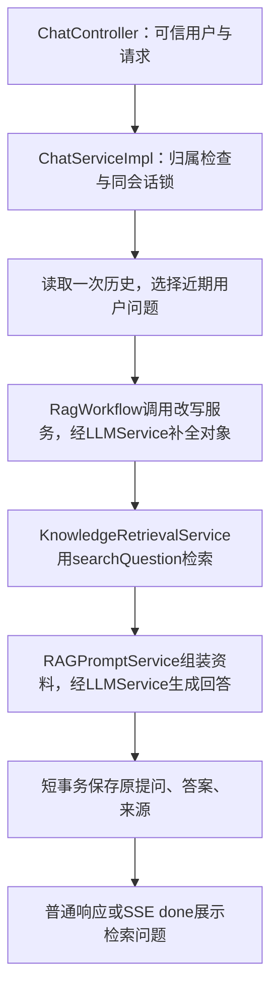

# D15：让连续追问带着明确对象去检索

实现日期：2026-11-02。本阶段只补全检索主体，没有引入Agent、多问拆分或重排。

后续架构对齐已完成：改写服务移至rag.core.rewrite，独立QueryRewriteClient合并到统一LLMService/ModelClient，当前结构与最新验证见 [架构说明](17-rag-architecture-alignment.md)。下方D15功能边界与历史验收记录保留。

## 在IDEA验收两轮

1. 重启RagentLearningApplication，强制刷新聊天页；沿用当前数据库、Redis和模型环境变量，没有新增必填凭证，也不需要重新解析、切分或向量化资料。
2. 选择包含星河验收资料且已向量化的知识库，新建会话。
3. 第一轮问“谁负责星河学习项目的验收？”。页面显示“首轮使用原问题”，没有额外改写调用。
4. 保持同一会话，问“它每周什么时候验收？”。本次回答上方应显示“用于检索的问题”，期望补全星河学习项目的主体，再依据本轮资料回答时间。
5. 最近历史仍保存用户原句，来源仍能核对；完整回答/逐段显示均可。真实模型措辞可以变化，不要求逐字匹配改写结果。

若显示“补全超时/补全暂不可用，使用原问题”，说明明确降级；原句“它”仍可能检索不到，不能算消解成功。可改用完整问法，并核对实际模型响应和超时预算。

## 三种问题与实际调用链

| 数据 | 示例与用途 |
| --- | --- |
| originalQuestion | “它每周什么时候验收？”：保存为用户提问，沿用原有首尾空白规范化 |
| searchQuestion | “星河学习项目每周什么时候验收？”：用于Embedding和pgvector检索 |
| modelQuestion | 原问题、检索问题和本轮sources的JSON：用于回答生成，检索问题本身不是事实证据 |

`ChatServiceImpl.chat/streamChat`先验证归属，在原同会话锁内读取一次历史，再协调改写、检索、生成和保存；模型等待不进入数据库事务，SSE worker仍显式接收可信userId。

`QueryRewriteServiceImpl.rewrite(question, history, cancellation)`负责业务策略：关闭开关或无历史用户问题时返回原句；否则仅选择最近最多6条用户提问、总计最多6000个Unicode码点。旧助手正文可能有错误金额或旧引用，不进入改写上下文。

改写服务通过`LLMService.chat(LLMRequest, cancellation)`复用现有模型地址、名称和密钥，将自己的总超时、输出上限与响应长度预算附在请求中。唯一协议实现为ModelClient，截止时间覆盖完整HTTP响应体，取消时终止未完成请求。基础聊天提示词保留原内容；独立QueryRewriteClient已移除。

模型只允许返回status/question两个字段。服务验证字段类型、状态、非空和8000字符上限；UNCHANGED/AMBIGUOUS必须原样返回当前问题。输出结构校验不能保证语义正确，仍须用实际追问检查是否补对主体。

## 状态、成本和兼容性

| retrievalQuery.status | 实际行为 |
| --- | --- |
| SKIPPED / DISABLED | 无历史/开关关闭，原句检索，不调用改写模型 |
| UNCHANGED | 调用改写模型后判断问题完整，保留原句 |
| REWRITTEN | 用补全后的问题检索 |
| AMBIGUOUS | 后端返回澄清提示，跳过Embedding和回答生成，原问题与澄清回复保存为一轮 |
| FALLBACK_TIMEOUT / FALLBACK_ERROR | 改写超时、HTTP故障或输出无效，明确回退原句；取消不会降级后继续运行 |

普通聊天不参与改写，retrievalQuery为null。知识库首轮没有额外调用，后续每轮默认额外调用一次现有聊天模型，即使结果UNCHANGED也有这次调用；正常分支继续原来的问题Embedding与回答生成，歧义澄清不再调用这两步。

可选配置：`RAG_REWRITE_ENABLED=true`、`RAG_REWRITE_TIMEOUT_MS=3000`，允许200—10000毫秒。关闭开关并重启可进行前后对比，不改变资料/索引。预算过短导致回退，不代表模型已成功理解追问。

普通响应和原SSE done新增retrievalQuery，包含originalQuestion/searchQuestion/status/durationMs；原answer/sources/knowledgeBaseId含义不变，start/delta/done/error事件名不变，仍保存成功后发done。页面用textContent显示检索问题，新请求、新建/切换会话、退出或认证失效时清理旧显示。

没有数据库迁移。历史只保存原提问、回答和来源快照；改写元数据仅在本轮响应中，不随历史重读返回，不能称为已实现完整Trace持久化。

## 原项目对应和学习版简化

参考 [MultiQuestionRewriteService](https://github.com/nageoffer/ragent/blob/c3b6157730ac1f66a312bcd286c47d3ee6aaac42/rag/src/main/java/com/nageoffer/ai/ragent/rag/core/rewrite/MultiQuestionRewriteService.java) 的调用位置、历史选择、结构化输出与失败回退。本阶段不复制术语映射、多问拆分、模型档位和完整追踪配置。

原项目还选取近期可用助手消息；学习版沿用D14的隔离边界，只发送用户问题。因此，需要旧助手名单才能确定的“第二个方案怎么样”等指代暂不保证支持；多个候选主体不明确应澄清。不能为了支持追问就把旧助手金额或引用恢复为可信事实。

改写服务没有星河/青禾等题目专用规则；相关分支仅存在于测试假模型。检索算法、Embedding模型与向量空间、来源排序和索引发布不变，后续Rerank单独实现与对比。

## 已执行验证

- 修改前文件及原有未提交文档备份：`data/query-rewrite-baseline-20261102-1793621075811`，保留用户工作，不自动提交或推送。
- Maven verify通过：共14个单元测试，原9个分块测试、新5个改写测试。新增本机HTTP测试覆盖跳过、用户历史边界、无效输出、完整响应体超时及取消传播。
- `RUN_BROWSER_CHECK=true`、`node scripts/verify-knowledge.mjs`通过58组，报告为`target/knowledge-test-1f3f38bd/result.json`。使用独立PostgreSQL/Redis、端口与存储，模型为本机假服务，不触碰用户业务数据。
- `verify-rewrite.mjs`覆盖原句检索无命中而补全后命中、不同会话独立主体、旧错误助手正文隔离、原话与来源保存、HTTP/JSON/超时回退、歧义澄清、SSE和Java重启恢复。
- Edge已验证检索问题展示、输入框和历史保留原话、退出清理；`target/knowledge-test-1f3f38bd/rag-chat-page.png`已检查布局。

上述自动回归未调用真实付费模型。假模型验证协议和控制分支，不代表系统性语义效果评测，也不声称准确率提高了某个百分比。可选真实服务脚本启用改写后也会增加调用，费用说明见脚本头；本轮未执行该脚本。

### 用户手动真实模型观察：2026-11-02

[观察记录](evaluation/2026-11-02-query-rewrite-observation.json)：用户在旧会话chat-D1401中先问星河验收负责人，再问“它每周什么时候验收？”。页面显示已补全为“星河学习项目每周什么时候验收”，回答每周四下午三点，并引用[1]。

助手只读核对数据库：用户原句连同输入的引号仍保存；[1]为01-星河项目验收.md，正文确实包含该时间，分数约0.77963。检索问题来自截图，数据库未保存改写元数据。此样例可确认连续追问补全、资料回答和原话保存已在用户真实模型中生效；该会话已有多个主题和星河验收时间完整问法，不是全新独立基线，也未完成歧义等场景的系统性真实评测。

额外的2024年6月20日出现在模型的假设例子中，不在资料里，不能当作知识库事实或系统当前日期。基础提示词仍保留举例要求，本次不因这个样例覆盖用户提示词。助手没有为核对而追加模型调用或改写业务记录。

建议手动提交说明：`feat(rag): 支持多轮检索问题改写与明确降级`。
