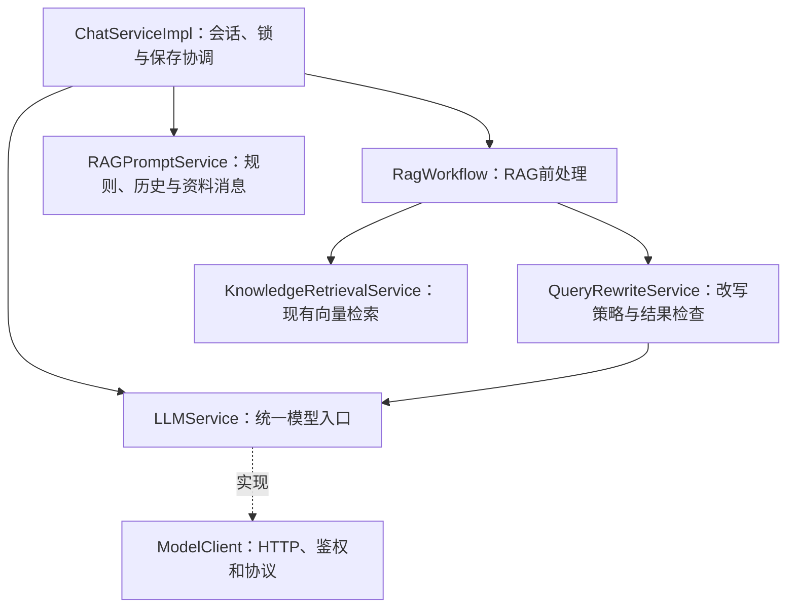

# RAG架构对齐：核心能力与统一模型入口

日期：2026-11-02。本轮落实用户要求：在现有工程上按原项目职责增量整理，再接重排。没有更换Java、Spring Boot、依赖版本或Maven模块，也没有修改数据库结构、资料、归属或认证协议。

2026-11-06补充：本页保留当时架构对齐记录；后续已在这里确定的边界接入可选重排和三段预算，当前实现见[重排说明](19-rerank-retrieval-budget.md)。

## 当前结构

五模块仍是framework、infra-ai、system、rag、bootstrap；模块依赖方向不变。这次只整理已有src/main/java中的职责包，没有给每个功能建立独立Maven模块。

```text
rag/src/main/java/com/dujiteng/ragentlearning/
├── chat/                       会话入口、协调与保存、HTTP DTO/VO
├── knowledge/                  文档、解析、分块、索引与检索
└── rag/core/
    ├── rewrite/                QueryRewriteService、RewriteResult
    │   └── impl/               QueryRewriteServiceImpl
    ├── workflow/               RagWorkflow、RagContext
    │   └── impl/               DefaultRagWorkflow
    └── prompt/                 RAGPromptService
        └── impl/               DefaultRAGPromptService

infra-ai/src/main/java/com/dujiteng/ragentlearning/infra/llm/
├── LLMService                  统一完整/流式模型接口
├── LLMRequest                  不可变消息与本次调用预算
├── ModelClient                 唯一Chat Completions协议实现
├── ModelResponseParser         原完整响应解析
├── ModelStreamParser           原SSE解析
└── StreamCancellation          原取消与流资源关闭
```

业务Service继续接口＋Impl。模型协议实现保持Client命名，避免为了形式再套一层没有职责的Impl。旧QueryRewriteClient已删除，其网络能力合并到ModelClient；改写Service移包，业务逻辑保留。

## 各层如何合作



`ChatServiceImpl.chat/streamChat`仍在进入模型前校验归属，在同会话锁内读取一次历史；知识库模式调用RagWorkflow.prepare，普通聊天直接使用原消息。拿到前处理结果后，只有需要生成时才调用提示词服务与LLMService，最终保存原提问、回答与来源。

`DefaultRagWorkflow.prepare`只协调改写、歧义判断、检索和无证据判断；返回RagContext（内部RewriteResult、来源、可选直接回复）。有歧义或没有证据时直接澄清/拒答，跳过回答模型。它不负责HTTP、SSE或数据库消息持久化，也不是完整Workflow引擎。

`DefaultRAGPromptService.build`把基础提示词、原问题、近期历史和本轮资料组装为LLMRequest。原SYSTEM_PROMPT仍在ChatServiceImpl，RAG规则、来源编号与旧助手正文隔离从原方法迁入，内容保持一致。资料仍作为user消息中的JSON，不提升为system指令。

`QueryRewriteServiceImpl`保留最近6条/6000个Unicode码点的用户提问、结构检查和降级策略；内部返回RewriteResult。外层通过QueryRewriteVO.from转换为原HTTP字段，核心包不反向依赖chat的DTO/VO。

## 统一模型调用解决什么

原先ModelClient与QueryRewriteClient各自维护地址、鉴权、载荷与响应处理。现在两类业务均依赖LLMService，参数随不可变LLMRequest传递：

| 调用 | 等待预算 | 生成参数 | 完整响应长度检查 |
| --- | --- | --- | --- |
| 回答 | 默认60000毫秒 | 沿用默认，不额外发送temperature/max_tokens | 沿用原普通回答策略 |
| 改写 | 默认3000毫秒，可配置 | temperature=0、max_tokens=512 | 保留65536字符限制 |

短超时、生成参数和长度预算属于每次请求，不修改共享客户端全局配置。LLMRequest复制消息列表及消息Map，避免调用参数被其他请求修改；参数只用于协议和预算，不包含知识库或用户归属业务。

非流式请求通过同一HTTP发送与解析路径等待完整响应体，短间隔等待只是检查取消，不重复发送请求。流式继续使用原ModelStreamParser、输入流关闭和取消链路，读取等待时间按本次请求设置。旧ModelClient.chat/stream便捷签名仍委托到统一实现，保留兼容。

MODEL_AUTH_FAILED、MODEL_RATE_LIMITED、MODEL_HTTP_ERROR、MODEL_CONNECTION_FAILED及响应/SSE错误分类继续保留。改写层将模型错误按是否带HttpTimeoutException原因分为超时或其他回退；StreamCancellation.Cancelled不被改写层吞掉。错误提示继续遮蔽密钥与完整对话内容。

## 保留的数据与外部行为

- 同一轮用户/助手消息、来源仍由ChatMemoryRepository经代理在短事务中保存，网络等待不进入数据库事务。
- 用户原话、历史窗口、知识库绑定和来源快照规则保留；改写结果不回写为用户问题。
- answer/sources/knowledgeBaseId/retrievalQuery字段保持，SSE仍为start/delta/done/error，保存成功后才发done。
- 页面、新配置、文档解析、索引版本和现有数据不因本次内部重构改变；无需重新向量化资料。
- 当前只有单实例会话锁、固定向量检索、基础改写；没有新增重排、多模型档位/路由或Agent能力。

## 原项目对应关系

本轮再次只读核对GitHub main，仍为[c3b6157](https://github.com/nageoffer/ragent/commit/c3b6157730ac1f66a312bcd286c47d3ee6aaac42)。对照的是职责和依赖，不复制全部类数量：

| 原项目入口 | 学习版落实 |
| --- | --- |
| [LLMService](https://github.com/nageoffer/ragent/blob/c3b6157730ac1f66a312bcd286c47d3ee6aaac42/infra-ai/src/main/java/com/nageoffer/ai/ragent/infra/chat/LLMService.java) | 统一模型接口＋请求对象；当前只有一个配置提供方，未复制档位和多模型路由 |
| [MultiQuestionRewriteService](https://github.com/nageoffer/ragent/blob/c3b6157730ac1f66a312bcd286c47d3ee6aaac42/rag/src/main/java/com/nageoffer/ai/ragent/rag/core/rewrite/MultiQuestionRewriteService.java) | 改写移至rag.core.rewrite，复用统一模型入口，保留当前单问题简化 |
| [RAGPromptService](https://github.com/nageoffer/ragent/blob/c3b6157730ac1f66a312bcd286c47d3ee6aaac42/rag/src/main/java/com/nageoffer/ai/ragent/rag/core/prompt/RAGPromptService.java) | 独立消息与资料组装；未复制动态模板管理和全部意图配置 |
| 固定RAG流程编排 | 从聊天协调中提取DefaultRagWorkflow前处理，后续检索后处理在此边界扩展 |

下一项Rerank应属于检索的候选后处理，按实际需要在检索服务/核心检索包中组织，再由RagWorkflow使用结果。Controller与聊天保存逻辑继续面向稳定接口。Agent和独立MCP模块在对应阶段增加。

## 本轮验证与本机操作

修改前完整源码、未提交D15文档与观测记录备份到`data/architecture-baseline-20261102-1793624869618`。该目录被忽略，不覆盖用户修改，不自动提交或推送。

为去掉已移动类的旧class，确认infra-ai/rag/bootstrap三个target均在工程内后仅清理这些模块，再从根执行verify与依赖类路径生成。根target中的既有报告和Edge测试依赖保留。

- Maven verify通过：19个单元测试（9分块、5改写、5统一模型入口）。新增HTTP测试覆盖参数隔离、并发短超时不污染另一请求、响应长度预算、鉴权/限流错误及敏感文本遮蔽、原SSE解析。
- 最终`RUN_BROWSER_CHECK=true`、`node scripts/verify-knowledge.mjs`：58组通过，报告`target/knowledge-test-ce9f0a8e/result.json`。使用独立PostgreSQL/Redis/端口/文件和本机假模型，包含登录、归属、事务、解析、索引、改写、取消、重启及Edge页面。
- 修改中先通过的18测试/58组记录为`target/knowledge-test-692c6263/result.json`；随后保留完整响应长度预算并增加专门测试，以上19测试/最终报告为最终版本。

本轮未执行真实付费模型请求；此前用户的真实改写样例保留为历史观察，不冒充本次架构版本的完整真实验收。本机需在IDEA重新构建/重启应用，再重放“谁负责星河学习项目的验收？”及“它每周什么时候验收？”；环境变量不变，仍用bootstrap类路径和工程根工作目录。

建议手动提交说明：`refactor(rag): 对齐核心职责并统一模型调用入口`。
